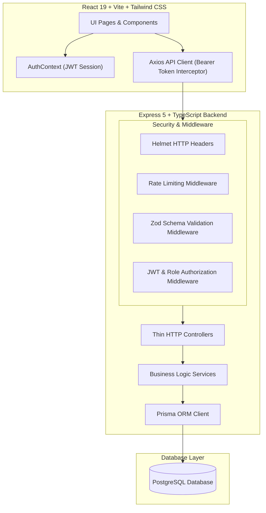
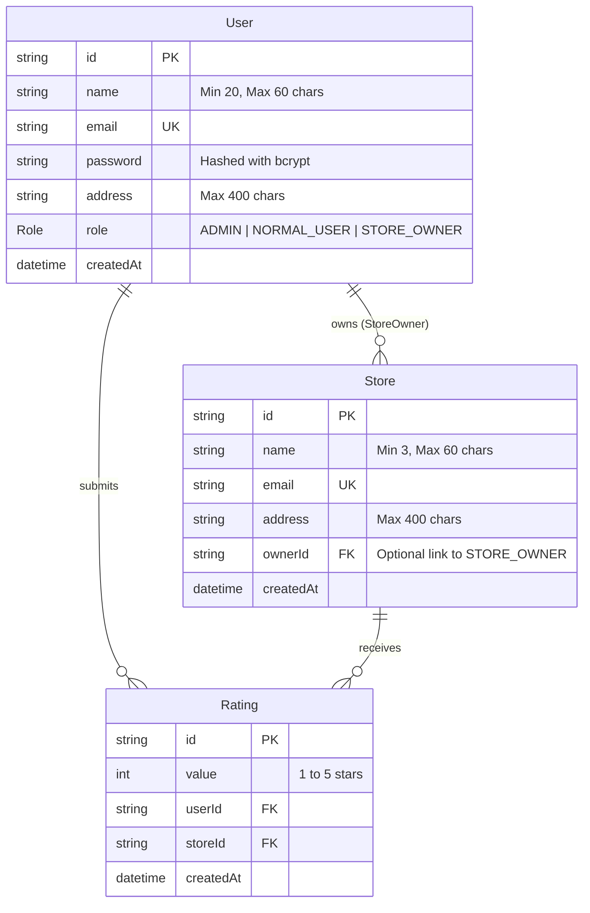

# 🏪 StoreRatings — Enterprise Full-Stack Rating & Review Platform

[](https://nodejs.org/)
[](https://expressjs.com/)
[](https://react.dev/)
[](https://www.typescriptlang.org/)
[](https://www.prisma.io/)
[](https://www.postgresql.org/)
[](https://zod.dev/)
[](https://vitest.dev/)

A production-grade, multi-role full-stack web application built to allow platform users to search, review, and rate registered stores (1 to 5 stars). Features centralized single login system, strict validation rules, role-based access control, interactive analytics dashboards, and automated integration testing.

---

## 📐 System Architecture

The platform follows a clean **Controller-Service-Schema (Layered)** architecture with decoupled concerns:



---

## 🗄️ Database Entity Relationship Diagram (ERD)



---

## 👥 User Roles & Key Capabilities

### 1. 🛡️ System Administrator (`ADMIN`)
- Access to platform metrics dashboard: **Total Users**, **Total Stores**, **Total Submitted Ratings**.
- Register new store listings and assign store owners.
- Create new user accounts (`ADMIN`, `NORMAL_USER`, `STORE_OWNER`).
- Browse & filter store listings with sorting on Name, Email, Address, and Overall Rating.
- Directory of all user accounts with filtering by Role, Name, Email, Address, and column sorting.
- Detailed User Modal: **If the user is a Store Owner, their store's overall average rating and ratings breakdown are displayed.**

### 2. 👤 Normal User (`NORMAL_USER`)
- Self-registration with real-time UI validation rules.
- View and search registered store listings by Store Name and Address.
- Interactive **1 to 5 Star Rating** widget: submit new rating or modify an existing rating.
- Sorting stores by Name, Address, Overall Rating, or My Rating.

### 3. 🏪 Store Owner (`STORE_OWNER`)
- Store Owner Dashboard with overall store average rating and total ratings count.
- Detailed table of customers who rated their store, showing Customer Name, Email, Rating, and Timestamp (with search & sorting).

### 4. 🔑 All Logged-in Users
- Centralized single login system.
- Account password update functionality.

---

## 🛡️ Form Validation Rules (Strict Compliance)

| Field | Rules | Error Message |
| :--- | :--- | :--- |
| **Name** | Min 20 characters, Max 60 characters | `Name must be between 20 and 60 characters long` |
| **Address** | Max 400 characters, Non-empty | `Address cannot exceed 400 characters` |
| **Password** | 8-16 characters, $\ge 1$ uppercase letter, $\ge 1$ special character | `Password must be 8-16 chars with 1 uppercase & 1 special character` |
| **Email** | Standard RFC email format | `Must follow standard email validation rules` |
| **Rating** | Integer between 1 and 5 | `Rating must be an integer between 1 and 5` |

---

## ⚡ Quick Start & Setup Guide

### Option 1: Launch with Docker Compose (Recommended)

Run the entire full-stack application (PostgreSQL + Express Backend + React Frontend):

```bash
docker compose up --build
```
- **Frontend App**: `http://localhost:3000`
- **Backend API**: `http://localhost:5001`

---

### Option 2: Local Manual Setup

#### Prerequisites:
- Node.js (v18+)
- PostgreSQL installed and running locally on `localhost:5432`

#### 1. Setup Backend:
```bash
cd backend
npm install

# Push database schema & seed initial data
npx prisma db push --accept-data-loss
npm run seed

# Run backend development server
npm run dev
```

#### 2. Setup Frontend:
```bash
cd frontend
npm install
npm run dev
```
Open `http://localhost:3000` in your browser.

---

## 🔑 Pre-Seeded Demo Accounts

| Role | Email | Password |
| :--- | :--- | :--- |
| **System Administrator** | `admin@storerating.com` | `AdminPass123!` |
| **Store Owner** | `johnathan.owner@techstore.com` | `OwnerPass123!` |
| **Normal User** | `christopher.user@gmail.com` | `UserPass123!` |

*(Quick-fill demo buttons are embedded directly on the Login page for rapid evaluation).*

---

## 🧪 Automated Integration Testing

Run the automated test suite powered by Vitest and Supertest:

```bash
cd backend
npm test
```

### Test Coverage Highlights:
- ✅ Health check endpoint validation.
- ✅ Registration & Login authentication flows.
- ✅ Validation rules enforcement (Name length, password rules, email format).
- ✅ Admin dashboard metrics & user detail modal data (store owner ratings).
- ✅ Normal user store listings & star rating submissions (1 to 5 range enforcement).
- ✅ Unauthorized access rejection (`401` & `403` HTTP status checks).

---

## 📁 Repository Structure

```
.
├── backend/
│   ├── src/
│   │   ├── config/          # Zod environment variable validation
│   │   ├── controllers/     # Thin HTTP route handlers
│   │   ├── services/        # Decoupled business logic services
│   │   ├── schemas/         # Zod request validation schemas
│   │   ├── middlewares/     # Auth, Zod validation, Rate limit, Global Error handler
│   │   ├── errors/          # Custom HTTP AppError class hierarchy
│   │   ├── utils/           # JWT & Logger helpers
│   │   ├── routes/          # Express route definitions
│   │   ├── app.ts           # Express Application factory
│   │   └── server.ts        # Server listener & graceful shutdown
│   ├── prisma/
│   │   ├── schema.prisma    # PostgreSQL Database Schema
│   │   └── seed.ts          # Database seed script
│   ├── src/__tests__/       # Vitest integration test suite
│   └── Dockerfile
├── frontend/
│   ├── src/
│   │   ├── components/      # StarRating, Badge, Modal, ErrorBoundary, Navbar
│   │   ├── context/         # AuthContext & JWT session persistence
│   │   ├── pages/           # Login, Signup, UpdatePassword, Admin, User, Owner views
│   │   ├── services/        # Axios API client with authorization interceptors
│   │   ├── types/           # TypeScript interfaces & data models
│   │   └── App.tsx          # App Router & ErrorBoundary wrapper
│   ├── Dockerfile
│   └── nginx.conf
└── docker-compose.yml
```
